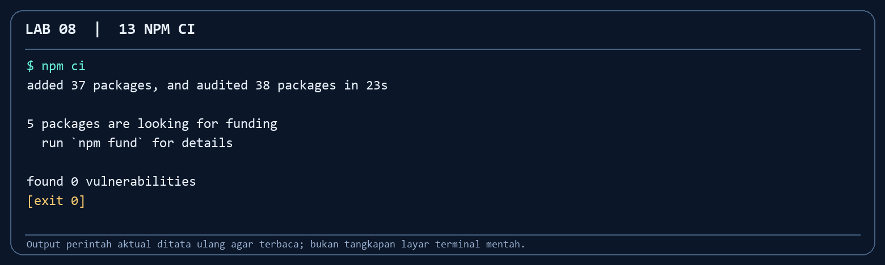
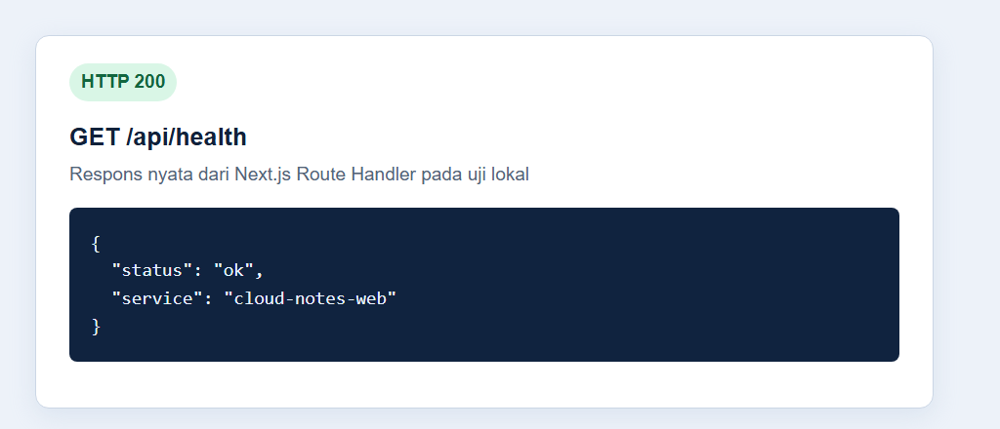
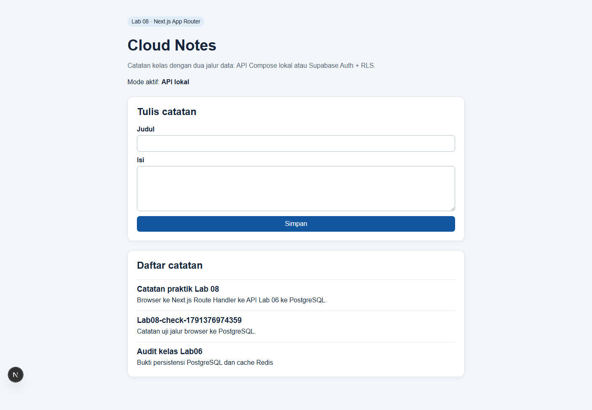
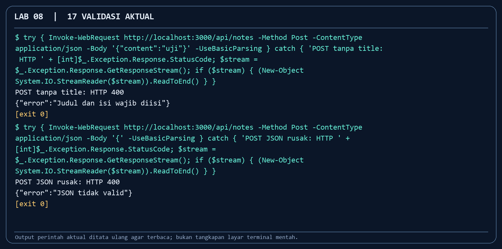
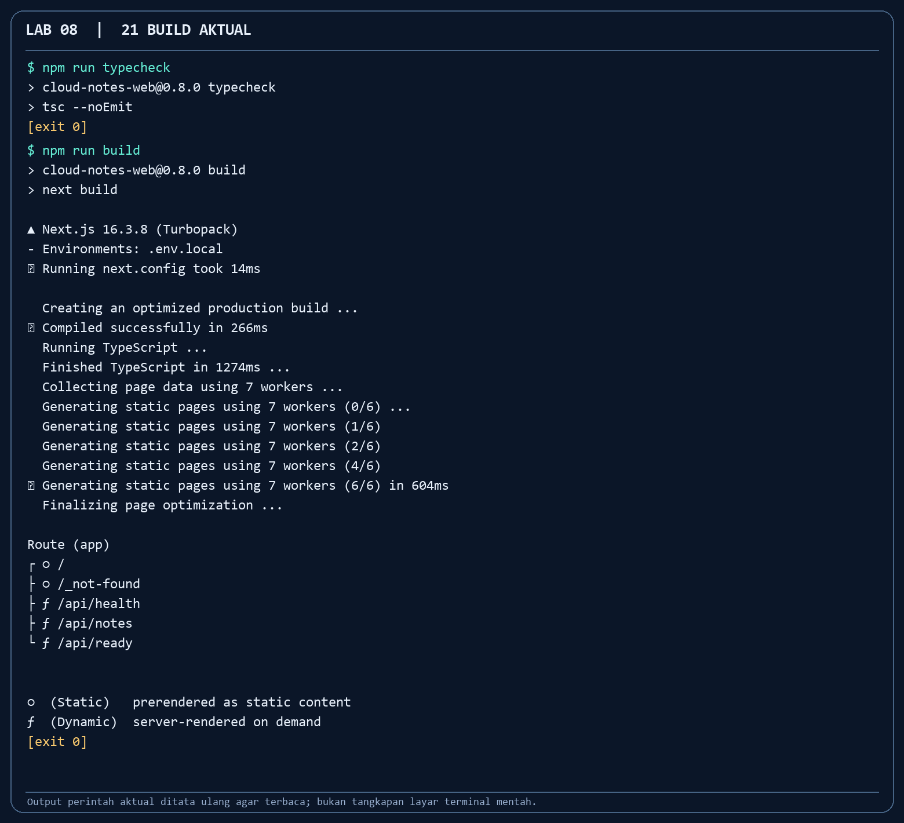
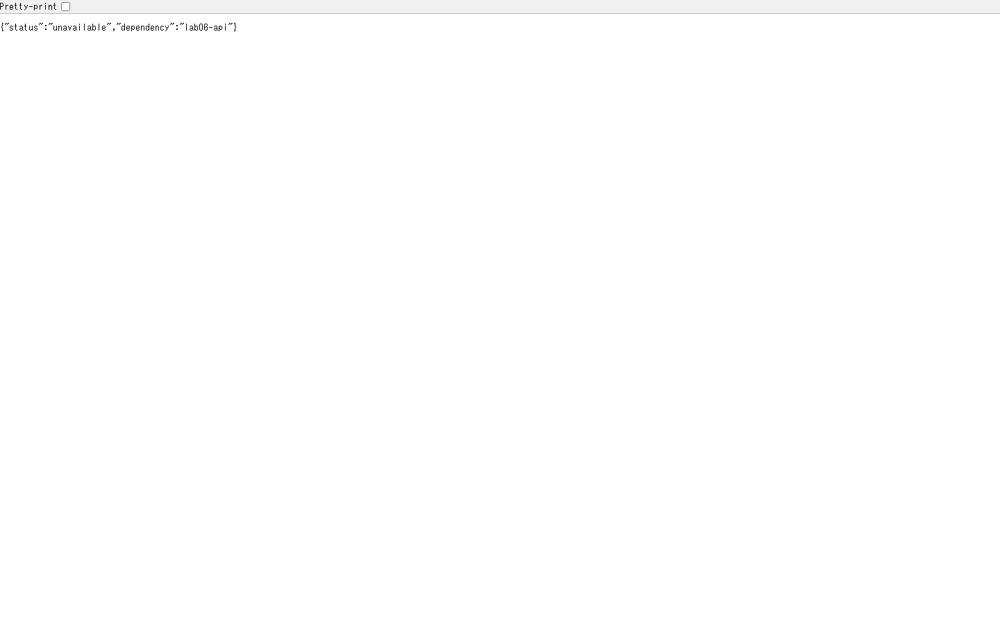

# Lab 08 — Next.js, Route Handler, dan Cloud Notes

**Kebijakan kelas:** Lab ini latihan formatif, tanpa tugas, nilai, atau penyerahan terpisah. Satu proyek besar dikerjakan oleh kelompok **3 orang**, dengan presentasi checkpoint minggu 7 (UTS) dan hasil akhir minggu 14 (UAS). Simpan hasil lab hanya bila berguna sebagai referensi atau bukti proses proyek. Baca [brief proyek kelompok](PROYEK_KELOMPOK.md). Bobot resmi tetap mengikuti RPS/LMS.

**Subtopik:** App Router, halaman dan komponen, GET/POST Route Handler, batas kode browser/server, konfigurasi Supabase, serta Git deployment ke Vercel. Praktik utama berjalan **lokal di Windows dengan PowerShell**. Bagian cloud berada setelah praktik lokal selesai.

## 1. Siapkan tiga terminal

Siapkan Docker Desktop yang Engine-nya berjalan, Git, serta Node **22 atau lebih baru**. Versi tersebut memenuhi dependensi Next.js dan Supabase pada lockfile proyek. Dua repo harus berada pada **komputer yang sama**.

| Terminal | Folder kerja | Fungsi |
|---|---|---|
| 1 | `meet6CloudService-local` | Menjalankan backend Compose dan memeriksa service |
| 2 | `meet8CloudService-local` | Menjalankan server Next.js dan melihat log |
| 3 | `meet8CloudService-local` | Mengirim request serta menjalankan pemeriksaan |

Buka **terminal 1** di folder tempat menyimpan proyek:

```powershell
git clone https://github.com/SeedFlora/meet6CloudService.git meet6CloudService-local
Set-Location .\meet6CloudService-local
Copy-Item .\.env.example .\.env
docker compose up --build -d --wait
docker compose ps
curl.exe -i http://127.0.0.1:18006/health
```

`--wait` menunggu API, database, dan cache sehat. Hasil terakhir harus **HTTP 200**, dengan JSON status ok, database postgres, cache redis. Backend yang sudah sehat dari Lab 06 boleh digunakan langsung: buka terminal di clone itu dan pertahankan `.env` serta volume yang sudah ada. Seluruh URL backend pada revisi ini memakai **18006**.


*Screenshot acuan berasal dari versi lama yang memakai port 8000. Gunakan 18006 pada perintah sekarang. Yang dibaca dari gambar ialah tiga service healthy, bukan angka port lama. Gambar dalam repo merupakan acuan uji terdahulu, bukan bukti mesin Anda.*

## 2. Jalankan frontend

Buka **terminal 2** di folder induk yang sama seperti awal terminal 1:

```powershell
git clone https://github.com/SeedFlora/meet8CloudService.git meet8CloudService-local
Set-Location .\meet8CloudService-local
Get-Location
node --version
npm --version
npm ci
Copy-Item .\.env.example .\.env.local
npm run dev
```

`Get-Location` harus berakhir dengan `meet8CloudService-local`. `node --version` harus menunjukkan 22 atau lebih baru, lalu `npm ci` memasang versi paket dari lockfile. `.env.local` mengatur `LOCAL_API_URL=http://127.0.0.1:18006`; dua variabel Supabase kosong agar mode lokal aktif. Pada clone lama, periksa konfigurasi yang sudah ada dan pertahankan nilai pribadi. File `.env.local` diabaikan Git.

`npm run dev` menjalankan proses terus-menerus. Biarkan terminal ini terbuka. Semua perintah pemeriksaan berikut memakai **terminal 3**, dibuka pada folder `meet8CloudService-local`.



*Hasil yang dibaca: instalasi selesai tanpa error. Jumlah paket dan pesan audit dapat berbeda. [Output acuan](screenshots/13_npm_ci.txt).*

Buka <http://localhost:3000> di Chrome. Label harus menunjukkan **Mode aktif: API lokal**. Jalankan di terminal 3:

```powershell
curl.exe -i http://localhost:3000/api/health
curl.exe -i http://localhost:3000/api/ready
```

Keduanya harus HTTP 200. `/api/health` menyatakan Next.js hidup. `/api/ready` juga memeriksa health API Lab 06; health frontend saja belum membuktikan database siap.



*Acuan respons health: HTTP 200. Status backend diperiksa melalui ready, bukan endpoint health ini.*

## 3. Simpan catatan dari browser

1. Pada form **Tulis catatan**, isi judul `Catatan kelas Next.js` dan isi `Browser memakai Route Handler server`.
2. Klik **Simpan** dan tunggu catatan muncul pada daftar.
3. Buka <http://127.0.0.1:18006/notes> di tab lain. Cari judul yang sama.
4. Di terminal 2, cari baris log JSON `notes_proxy`: log memuat status, `requestId`, dan durasi tanpa isi catatan.



*Hasil yang diharapkan: judul dan isi baru terlihat pada daftar. Data berasal dari PostgreSQL melalui API Lab 06. Ambil screenshot hasil laptop sendiri bila berguna untuk proyek kelompok.*

Alirannya: browser mengirim `/api/notes`, Route Handler Next.js memvalidasi request, API Lab 06 menyimpan ke PostgreSQL, lalu frontend membaca daftar terbaru. Redis dipakai oleh API Lab 06; browser tidak mengakses database atau jaringan Compose langsung.

## 4. Uji GET, POST, dan input salah

Gunakan terminal 3. Untuk POST, kirim JSON lewat input standar agar tanda kutip tetap utuh pada Windows PowerShell:

```powershell
'{"title":"Uji Route Handler","content":"POST dari PowerShell"}' | curl.exe -i http://localhost:3000/api/notes -H 'Content-Type: application/json' --data-binary '@-'
curl.exe -i http://localhost:3000/api/notes
```

POST harus menghasilkan **HTTP 201** dan catatan dengan ID. GET harus **HTTP 200** serta daftar yang memuat judul itu. Respons membawa header `X-Request-ID`; cocokkan nilainya dengan `requestId` pada log terminal 2 untuk menelusuri request.

Sekarang kirim body tanpa judul:

```powershell
'{"content":"tanpa judul"}' | curl.exe -i http://localhost:3000/api/notes -H 'Content-Type: application/json' --data-binary '@-'
```

Hasil yang benar adalah **HTTP 400** dengan pesan bahwa judul dan isi harus terisi. Input ini ditolak sebelum diteruskan ke backend. `curl.exe -i` tetap menampilkan status dan body error, sehingga tidak perlu `try/catch` PowerShell.



*Acuan: request tanpa judul dan JSON rusak menghasilkan HTTP 400. ID, timestamp, serta rincian tampilan terminal dapat berbeda. [Output acuan](screenshots/17_validasi_aktual.txt).*

## 5. Kenali source yang bekerja

Buka file berikut pada VS Code:

| File | Bagian yang dibaca | Fungsi |
|---|---|---|
| `src/app/page.tsx` | `'use client'`, state, form, `fetch('/api/notes')` | Interaksi dan tampilan browser |
| `src/app/api/notes/route.ts` | `GET`, `POST`, `LOCAL_API_URL` | Proxy serta validasi pada server Next.js |
| `src/app/api/health/route.ts` | Respons status ok | Liveness Next.js |
| `src/app/api/ready/route.ts` | Pemeriksaan `/health` API Lab 06 | Readiness dependensi |
| `src/lib/supabase.ts` | `NEXT_PUBLIC_SUPABASE_*` | Mengaktifkan mode Supabase pada bagian tambahan |

Untuk mencari baris pada PowerShell:

```powershell
Select-String -Path .\src\app\page.tsx, .\src\app\api\notes\route.ts -Pattern 'use client', 'fetch', 'LOCAL_API_URL', 'export async function'
```

`LOCAL_API_URL` hanya dibaca Route Handler server. Variabel `NEXT_PUBLIC_` masuk bundle browser ketika build; URL serta publishable key Supabase memang untuk klien dengan RLS, sedangkan service role/secret key harus tetap rahasia.

## 6. Typecheck, build, dan selesai

Di **terminal 2**, tekan `Ctrl+C` untuk menghentikan server dev. Setelah berhenti, jalankan dari folder Lab 08:

```powershell
npm run typecheck
npm run build
```

Typecheck harus selesai tanpa error TypeScript. Build harus exit code 0 dan menampilkan route aplikasi. Untuk membuka web lagi, jalankan `npm run dev` pada terminal 2.



*Baca hasil: typecheck dan build selesai tanpa error. [Output acuan terdahulu](screenshots/21_build_aktual.txt). Ini tidak menggantikan pemeriksaan source pada mesin Anda.*

Setelah frontend berhenti dan backend tidak dipakai lab lain, jalankan di **terminal 1**:

```powershell
docker compose down
```

Volume database tetap tersimpan. Laporan, screenshot pribadi, checker, dan push ke repo sendiri merupakan latihan tambahan.

## Pembahasan

| Pertanyaan | Jawaban |
|---|---|
| Mengapa halaman memakai `'use client'`? | State, form, dan event membutuhkan kode browser. |
| Mengapa proxy berada di Route Handler? | Koneksi ke API lokal serta validasi diproses server Next.js. |
| Apa beda HTTP 400 dan 503? | 400 berarti input salah. 503 berarti dependensi layanan tidak tersedia. |
| Apakah Edge sama dengan SSR/SSG/ISR? | Edge adalah pilihan runtime. SSR, SSG, dan ISR menjelaskan kapan halaman dibuat atau diperbarui. |
| Apakah daftar catatan aman menjadi halaman statis bersama? | Data privat per pengguna perlu konteks sesi dan pembatasan akses, bukan satu hasil statis bersama. |

## Tambahan A. Outage dan checker

Bagian ini mengubah status service latihan. Jalankan setelah catatan berhasil tersimpan.

1. Di terminal 1 jalankan `docker compose stop api`.
2. Di terminal 3 jalankan:

```powershell
curl.exe -i http://localhost:3000/api/health
curl.exe -i http://localhost:3000/api/ready
curl.exe -i http://localhost:3000/api/notes
```

Hasil yang diharapkan: **200, 503, 503**. Next.js masih hidup, tetapi backend tidak tersedia. Refresh browser untuk melihat pesan API lokal gagal.

3. Di terminal 1 pulihkan dengan `docker compose up -d --wait api`. Ulangi ready dan notes di terminal 3; keduanya kembali **200**, dan catatan lama tetap terlihat.
4. Dari terminal 3 jalankan `npm run check:local`. Checker membuat satu catatan berjudul `Lab08-check-...` dan menguji penulisan serta pembacaan. Target **9 PASS, 0 FAIL**. Checker tidak menggantikan pemahaman aliran request.



*Hasil outage yang diharapkan: ready 503. Screenshot acuan berasal dari pengujian terdahulu, bukan simulasi yang otomatis berjalan pada mesin Anda.*

## Tambahan B. Supabase dan Vercel

Jalur ini memerlukan akun Supabase, GitHub, dan Vercel. Praktik lokal tetap selesai tanpa akun tersebut. Deployment publik memakai Supabase karena API `localhost` di laptop tidak dapat diakses dari Vercel.

1. Di proyek Supabase, buka **SQL Editor** dan jalankan `schema.sql` dari [Lab 07](https://github.com/SeedFlora/meet7CloudService). Tabel `notes` menyimpan `user_id` dan policy RLS milik pengguna.
2. Isi `.env.local` di root Lab 08 dengan `NEXT_PUBLIC_SUPABASE_URL` serta `NEXT_PUBLIC_SUPABASE_PUBLISHABLE_KEY` milik proyek. Pertahankan `LOCAL_API_URL` untuk latihan lokal; mode Supabase aktif ketika dua variabel publik terisi.
3. Hentikan server dan jalankan kembali `npm run dev`. Halaman harus menyebut **Mode aktif: Supabase**. Klik **Daftar**, gunakan akun latihan, selesaikan konfirmasi email yang diminta, kemudian **Masuk** dan buat catatan.
4. Keluar dan ulangi dengan akun latihan kedua. Akun kedua tidak boleh melihat catatan pertama. Policy memakai JWT pengguna melalui `auth.uid()`; publishable key saja tidak memberi identitas pengguna.
5. Buat repo milik sendiri melalui **Use this template** pada GitHub Lab 08. Ikuti [panduan Git opsional](PANDUAN_GIT.md) untuk menyimpan source ke repo itu. `.env.local`, `.next`, dan `node_modules` tetap diabaikan Git.
6. Di Vercel pilih **Add New → Project**, import repo pribadi, framework **Next.js**, root directory **`.`**. Isi dua variabel `NEXT_PUBLIC_SUPABASE_*` pada environment project sebelum deploy. Jangan mengisi `LOCAL_API_URL` dengan alamat laptop sebagai backend publik.
7. Klik **Deploy**, buka URL hasilnya, lalu uji login dan catatan dua akun. Perubahan environment publik memerlukan deployment baru karena nilainya masuk bundle pada build.
8. Push perubahan tampilan kecil ke branch pribadi dan amati deployment baru. Branch nonproduksi memberi preview; branch produksi memberi deployment produksi. Custom domain tambahan dapat dipasang melalui **Settings → Domains** dengan mengikuti record DNS yang ditampilkan Vercel untuk domain sendiri.

Screenshot cloud harus berasal dari proyek sendiri dan menyamarkan email/token. Tidak ada klaim bahwa gambar lokal membuktikan deploy cloud. Rujukan: [Route Handlers](https://nextjs.org/docs/app/getting-started/route-handlers), [Vercel Git](https://vercel.com/docs/git), [Supabase security](https://supabase.com/docs/guides/database/secure-data).

## Kendala umum

| Gejala | Pemeriksaan |
|---|---|
| Node/EBADENGINE | Gunakan Node 22+, buka ulang terminal, periksa versi sebelum `npm ci`. |
| Port 3000 dipakai | Hentikan server Next.js lama atau lab lain yang memakai port ini. |
| Ready 503 | Periksa Lab 06 di 18006 dan `LOCAL_API_URL` pada `.env.local`; restart Next setelah perubahan. |
| Mode Supabase muncul saat ingin lokal | Kosongkan dua `NEXT_PUBLIC_SUPABASE_*`, lalu restart server. |
| `npm ci` EPERM/ENOTEMPTY | Hentikan proses Next.js milik repo ini yang masih memakai `node_modules`, lalu ulangi instalasi. |
| Build gagal | Baca file/baris yang dilaporkan TypeScript; perbaiki sebelum mengulang build. |
